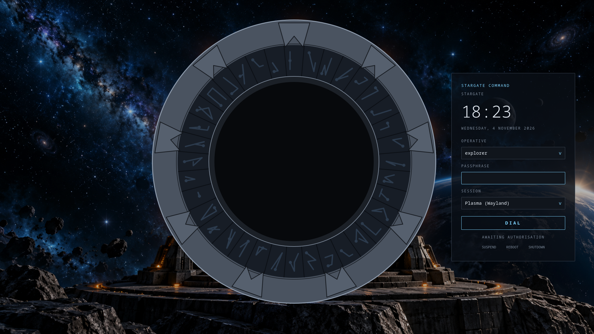
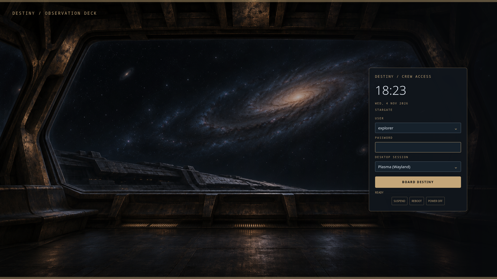
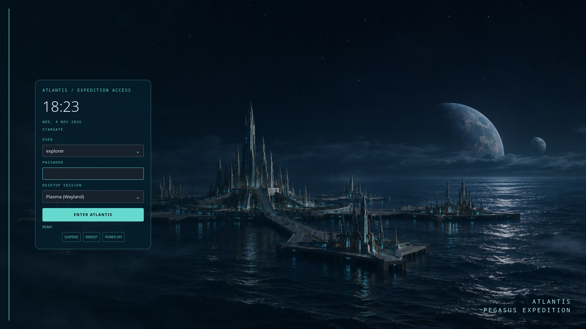
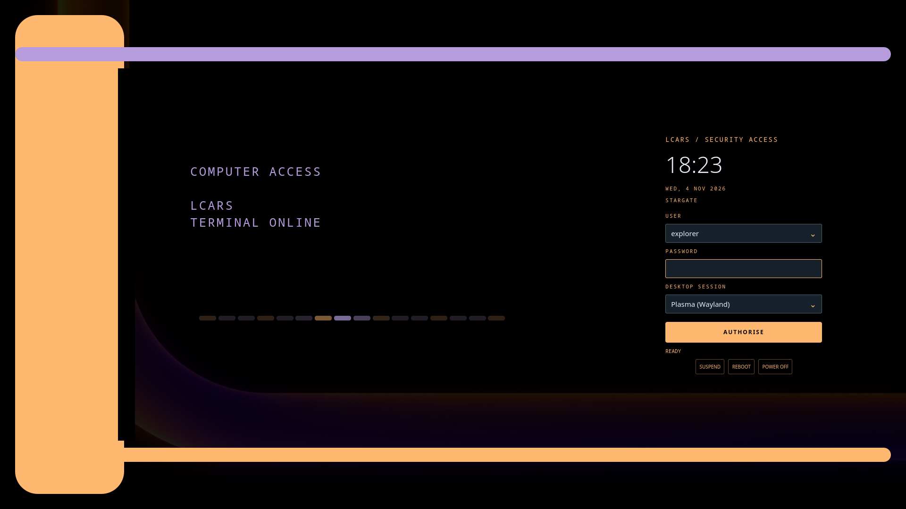

# hypr-w89-arch

Stargate / Star Trek themed Arch Linux desktops: Hyprland and KDE Plasma, with shared wallpapers and colour schemes.

**Credit:** fork of [LinuxBeginnings/Arch-Hyprland](https://github.com/LinuxBeginnings/Arch-Hyprland) (KooL's Arch-Hyprland). Licence GPL-3.0 (`LICENSE.md`).

## Scripts

| Script | Use |
|---|---|
| `./install.sh --desktop hyprland` | Hyprland installer (existing menu; also the default without `--desktop`) |
| `./install.sh --desktop plasma` | Plasma desktop packages, shared wallpapers and colours |
| `./desktop.sh --desktop NAME` | Apply a shared scheme and/or wallpaper through a desktop backend |
| `./wallpapers.sh` | List or copy the common wallpaper collection |
| `./theme.sh` | Apply one scheme to chosen targets; whiptail menu without arguments, else `--scheme NAME [targets]`. Targets are documented under each section below |
| `./sddm-theme.sh` | SDDM theme only, no `install.sh` |

`./theme.sh` flags: `--scheme`, `--kitty`, `--gtk`, `--kde`, `--zsh [THEME]`, `--sddm`, `--hypr`, `--plasma`, `--desktop NAME`, `--wallpapers [DIR]`, `--all`, `--list`.

## Choose a desktop

```bash
# Existing Hyprland package/dotfiles menu
./install.sh --desktop hyprland

# Basic Plasma desktop, common wallpapers and the default palette
./install.sh --desktop plasma

# Preview the Plasma install without changing anything
./install.sh --desktop plasma --dry-run

# Theme an existing Plasma installation without installing packages
./install.sh --desktop plasma --theme-only --scheme stargate-blue-dark

# Apply a scheme and wallpaper from the running desktop session
./desktop.sh --desktop plasma --scheme stargate-blue-dark --wallpaper stargate-alien-city-centre
./desktop.sh --desktop hyprland --scheme stargate-dark --wallpaper stargate-universe-dark-gate

# Copy wallpapers independently of any desktop or palette
./wallpapers.sh --install
./wallpapers.sh --install "$HOME/Pictures/Stargate"
./wallpapers.sh --list
./install.sh --list-desktops
```

Shared assets are in `assets/wallpapers/` and `assets/themes/`. Desktop installers
and theme adapters are in `desktops/<name>/`. Both desktops can coexist and use
the same `~/Pictures/wallpapers` collection; existing images are kept when copied.
Pass `--wallpapers-dir DIR` to the Plasma installer to choose another destination.
Use an image's bundled filename, basename without `.png`, or an external path
with `desktop.sh --wallpaper`.

Plasma setup is separate from the Hyprland installer's `kde` option, which installs
KDE applications inside Hyprland. The Plasma installer uses the existing login
manager; select Plasma at login. SDDM and boot themes are separate commands. When
run outside Plasma, colours are configured for the next login and an explicitly
requested wallpaper command is printed for use after login. Live wallpaper
changes require the matching running desktop session. Hyprland additionally needs
its installed dots/theme overlay and a running `awww` or `swww` daemon.

`theme.sh --plasma` applies a palette through Plasma's activation tool.
`theme.sh --all` applies shared targets plus the current desktop; it includes the
SDDM target, which uses sudo. `uninstall.sh` is the existing **Hyprland-only**
configuration removal script; it is not a Plasma uninstaller.

See [desktops/README.md](desktops/README.md) for the backend contract and how to add
another desktop. Validate without touching the live desktop with
`python3 -m unittest discover -s tests -v`.

## SDDM theme only: `./sddm-theme.sh` (no `install.sh`)

`./sddm-theme.sh <command> [options]`

| Command | Does |
|---|---|
| `themes` | List bundled login-screen designs |
| `set` | Install + activate (default) |
| `export` | Build a self-contained theme directory (`--output DIR`) |
| `test` | Preview window, installs nothing |
| `remove` | Delete theme, restore config |
| `status` / `schemes` / `backgrounds` | Show active theme / list schemes / list backgrounds |

| Option | Does |
|---|---|
| `--theme NAME` | Choose `stargate`, `stargate-universe`, `atlantis`, or `lcars` |
| `--scheme NAME` | SDDM accent + gate colour from a palette |
| `--output DIR` | New destination directory for `export` |
| `--no-animations` | Static Destiny, Atlantis or LCARS layout |
| `--background NAME\|FILE` | Background image (bundled or path) |
| `--kitty` | Write + select a kitty theme from `--scheme` (default `stargate-carbon-dark`) |
| `--wallpapers [DIR]` | Copy bundled wallpapers (default `~/Pictures/wallpapers`, existing files kept) |
| `--theme-dir DIR` | Theme source |

`./theme.sh --sddm` runs `sddm-theme.sh set --scheme` (sudo).

## Install

| Step | Command |
|---|---|
| Run from repo root | `chmod +x install.sh && ./install.sh` |
| Preset | `./install.sh --preset <file>` |
| Single script | `cd` repo root, then `./install-scripts/<name>.sh` |
| Remove Hyprland configs | `./uninstall.sh` (Hyprland only) |

- Scripts `cd` to the repo root; never run them from inside `install-scripts/`.
- Needs Arch Linux, a normal user with sudo, an internet connection.
- Logs: `Install-Logs/`.

## Menu options (themed)

| Option | What it does |
|---|---|
| `sddm_theme` | Bundled Qt6 Stargate login theme -> `/usr/share/sddm/themes/stargate` |
| `dots` | Installs the bundled `vendor/Hyprland-Dots`, then applies the theme overlay |
| `star_lore` | [fastfetch-star-lore](https://github.com/warkanum/fastfetch-star-lore), Stargate + Star Trek only |
| `kde` | Dolphin + KDE apps, Breeze, KDE portal; Qt themed with KDE (replaces Thunar/Fusion) |
| `gtk_themes` | Minimal GTK: Flat-Remix + Bibata cursor, for GTK apps only (audited, neutral) |

Other options (sddm, zsh, bluetooth, thunar, nvidia, rog, ags, quickshell) are unchanged from upstream.

## SDDM theme collection (`assets/sddm-themes`)

Each theme has its own directory. The original `stargate` theme retains its
dialing-gate animation. Three additional layouts use the common wallpapers:

- `stargate-universe`: Destiny observation window, drifting starlight and a bronze crew-access panel.
- `atlantis`: ocean city panorama, subtle water reflections and a teal expedition panel.
- `lcars`: rounded orange and violet console rails with scanning segments on black.

```bash
./sddm-theme.sh themes
./sddm-theme.sh test --theme stargate-universe
./sddm-theme.sh test --theme atlantis
./sddm-theme.sh set --theme lcars
./sddm-theme.sh export --theme atlantis --output /tmp/atlantis-sddm
./sddm-theme.sh test --theme lcars --no-animations
```

Previews and exports change no login settings. Installation takes effect at the
next login without restarting SDDM. The three newer themes also animate panel
entrance and login feedback; use `--no-animations` for a static version.
Authentication starts immediately when submitted. The Hyprland installer still chooses
`stargate` by default; set `SDDM_THEME=atlantis` to choose another theme through
its SDDM-theme option. All themes offer the installed Plasma/Hyprland sessions.
See [the theme collection guide](assets/sddm-themes/README.md) for packaging,
custom backgrounds, removal behaviour, and tests.

### SDDM theme previews

Rendered at 1920×1080 with a mock user and session list. Click an image for the
full-size screenshot.

| Stargate — original dialing gate | Destiny — Stargate Universe |
|---|---|
| [](docs/screenshots/sddm/stargate.png) | [](docs/screenshots/sddm/stargate-universe.png) |
| **Atlantis — Pegasus expedition** | **LCARS — computer access** |
| [](docs/screenshots/sddm/atlantis.png) | [](docs/screenshots/sddm/lcars.png) |

Regenerate screenshots with Python and PySide6 installed:

```bash
for theme in stargate stargate-universe atlantis lcars; do
  PYTHONDONTWRITEBYTECODE=1 python3 tools/screenshot-sddm.py "$theme"
done
```

The capture tool renders offscreen and does not change the active login screen.

### Original dialing-gate theme

- Pegasus-style gate: 7 glyphs dialled, chevrons lock, kawoosh on success, red flash on failure.
- Background: `stargate-space.png`. Colours: `theme.conf` (`accent`, `horizon`).
- Test: `./sddm-theme.sh test --theme stargate`

| Key (test window) | Effect |
|---|---|
| `Ctrl+Shift+O` | Toggle open gate + blue splash |
| `Ctrl+Shift+F` | Play failed dial |

Keys are visual only; they never log in.

## Shared palettes and Hyprland theme

Runs after the dots (`install-scripts/hypr_theme.sh`):
installs schemes + `hypr-theme`, removes stock wallpapers and Japanese wlogout presets (sekiro, kurenai, fuji), blocks the Wallpaper-Bank download, pins `stargate-carbon-dark`.

| Scheme | Look |
|---|---|
| `stargate-carbon-dark` | Carbon black + Stargate blue (default) |
| `stargate-blue-dark` | Event-horizon blue on deep navy |
| `stargate-dark` | Dark grey stone, steel-blue accent |
| `atlantis-teal-dark` | Pegasus ocean teal |
| `ancient-aurora-dark` | Ancient outpost green / violet aurora |
| `goauld-gold-dark` | Gold on black |
| `wraith-hive-dark` | Toxic green, amber |
| `replicator-silver-dark` | Cold silver-grey |
| `star-trek-lcars-dark` | Orange / peach / violet on black |
| `starfleet-blue-dark` | Command gold, science blue, ops red |
| `vulcan-amber-dark` | Desert amber |
| `klingon-red-dark` | Blood red on black |
| `romulan-green-dark` | Dark green |
| `borg-collective-dark` | Terminal green on black |
| `section-31-dark` | Near-black, muted steel |
| `stargate-oled-dark` | Pure black `#000`, Stargate blue accent |
| `stargate-gunmetal-dark` | Gunmetal surfaces, ice-blue accent |
| `stargate-midnight-dark` | Very dark navy, event-horizon blue |
| `atlantis-abyss-dark` | Near-black, deep ocean teal |

All schemes are dark; names end in `-dark`. Old names (e.g. `stargate-blue`) still resolve to the `-dark` file.

| Command | Does |
|---|---|
| `hypr-theme list` | List schemes |
| `hypr-theme current` | Show active |
| `hypr-theme set <name>` | Apply to waybar, rofi, kitty, hyprland, etc. |

| `theme.sh` flag | Does |
|---|---|
| `--hypr` | `hypr-theme set` for Hyprland, waybar, rofi (needs the dots; KDE colours skipped, use `--kde`) |
| `--wallpapers [DIR]` | Copy bundled wallpapers (default `~/Pictures/wallpapers`, existing files kept) |
| `--list` | List schemes |
| `--all` | Every target |

- Wallpapers: `assets/wallpapers/` -> `~/Pictures/wallpapers`.
- Includes Stargate, Atlantis, Universe, alien worlds, and Star Trek wallpapers. Prompts and generation status are in `assets/WALLPAPERS.md`.

## Kitty (`theme.sh --kitty`)

- Writes the scheme as a kitty theme next to every existing `kitty.conf` (`$KITTY_CONFIG_DIRECTORY`, `~/.config/kitty`, hypr `UserConfigs`), repoints the include line, reloads running kitty (SIGUSR1).

## GTK (`theme.sh --gtk`)

- Writes `@define-color` blocks into `gtk-3.0/gtk.css` and `gtk-4.0/gtk.css`, sets dark preference.
- Full effect on GTK4/libadwaita; GTK3 only for themes using the named colours.
- Only the block between `hypr-w89 theme begin/end` is rewritten; other content is kept.

## Zsh themes (`assets/add_zsh_theme`, `theme.sh --zsh [THEME]`)

- Prompts: `stargate` (default), `lcars`, `stargate-minimal`; upstream themes stay installed.
- Installed to `~/.oh-my-zsh/custom/themes` (by `zsh.sh` and `--zsh`).
- `--zsh` writes `~/.config/hypr-w89/zsh-colors.zsh` (prompt, autosuggestion, syntax-highlight colours, sourced by `.zshrc`); `THEME` also sets `ZSH_THEME` in `~/.zshrc`.
- Truecolor hex; without the colours file the built-in Stargate colours are used.

## Boot chain (`assets/boot-stargate`, `install-scripts/boot_theme.sh`)

- Plymouth `stargate`: 9 chevrons lock as boot progresses, event horizon opens at the end, passphrase prompt styled.
- GRUB theme (GRUB only): space background, right-hand "Stargate Command" menu, "Dialling in N..." timeout.
- systemd-boot: Plymouth only (no bootloader theme).
- Edits `/etc/mkinitcpio.conf`, kernel cmdline (`quiet splash`), `/etc/default/grub`; backups in `~/.cache/hypr-w89-boot-backup`.
- Undo: `./install-scripts/boot_theme.sh --revert` (from repo root).
- Regenerate images: `python3 assets/boot-stargate/tools/generate.py` (needs python-pillow).
- Secure Boot: re-sign the initramfs/UKI if you sign them.

## KDE applications in Hyprland (`install-scripts/kde.sh` + `hypr_theme.sh`)

- Also: kwallet + kwallet-pam (auto-unlock via SDDM PAM, needs wallet password = login password), kwalletmanager, ksshaskpass (`SSH_ASKPASS`), kdeconnect, kcalc, kdialog, kfind, filelight, partitionmanager.
- Warns if gnome-keyring is installed (both claim `org.freedesktop.secrets`); it is never removed.
- Installs dolphin, ark, kio-extras, gwenview, okular, kate, breeze, plasma-integration, xdg-desktop-portal-kde.
- Dolphin = default file manager. Default apps: Ark (archives), Gwenview (images), Okular (pdf/epub), Kate (text).
- Dialogs: `~/.config/xdg-desktop-portal/hyprland-portals.conf` sends FileChooser, AppChooser, Print and Settings to the KDE portal; `GTK_USE_PORTAL=1` makes GTK apps use it. Screen sharing stays on the Hyprland portal.
- Browsers: Firefox gets `widget.use-xdg-desktop-portal.*` prefs (system default + existing profiles' `user.js`); Chromium-based browsers follow `GTK_USE_PORTAL=1`.
- Thumbnails: kio-extras, kdegraphics-thumbnailers (pdf/ps/raw), ffmpegthumbs (video), kimageformats + qt6-imageformats (avif/heif/jxl/webp/exr...), taglib (audio covers). Thunar option: tumbler, ffmpegthumbnailer, poppler-glib, libgsf, libopenraw, webp/heif/jxl loaders, epub.
- Integration: `qt6-wayland`, `udisks2` (Dolphin devices), `archlinux-xdg-menu` + `XDG_MENU_PREFIX=arch-` + `kbuildsycoca6` ("Open with" menu), D-Bus activation env set at session start.
- Services: `kded6` (started with the session), `kglobalacceld` (global shortcuts, D-Bus activated). KDE app notifications go to the running daemon (swaync); KDE's own notification daemon is part of plasma-workspace and is not installed.
- Env lives in `UserConfigs/user_env.lua` and startup in `UserConfigs/user_startup.lua` (marker `hypr-w89 kde`).
- After the dots: `QT_QPA_PLATFORMTHEME=kde`, Fusion override removed, `files = dolphin`.
- `theme.sh --kde` writes the scheme to `~/.local/share/color-schemes` and merges it into `kdeglobals`.
- `hypr-theme set` also writes `~/.local/share/color-schemes/<name>.colors` and merges it into `~/.config/kdeglobals` (Breeze style, breeze-dark icons).
- Select `kde` before `dots` (menu order does this).

See `CHANGELOGS.md`.
